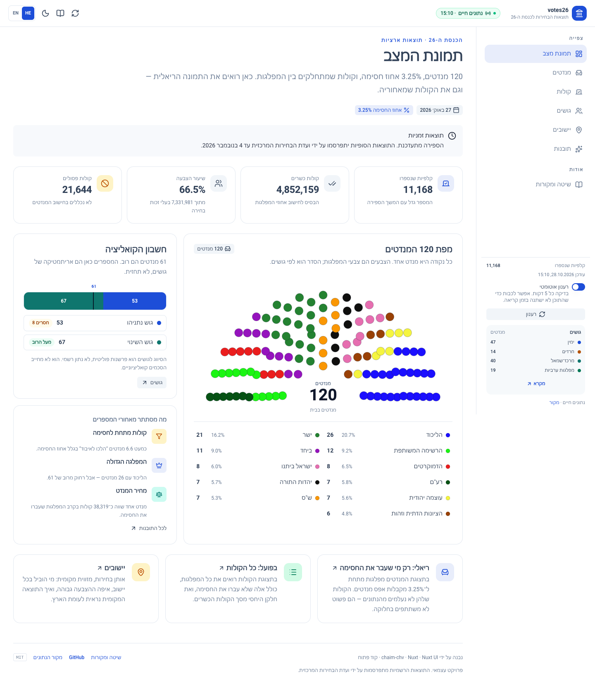
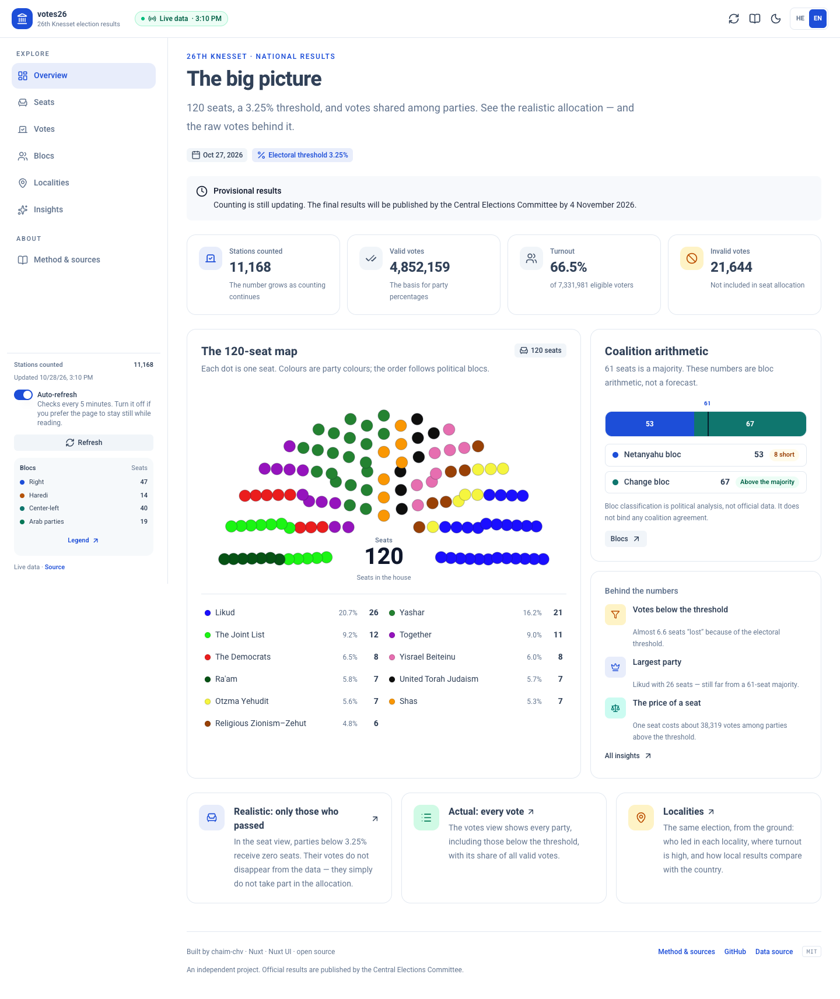
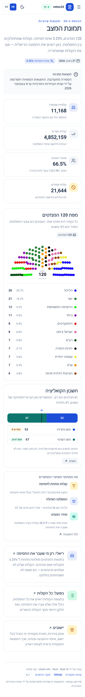
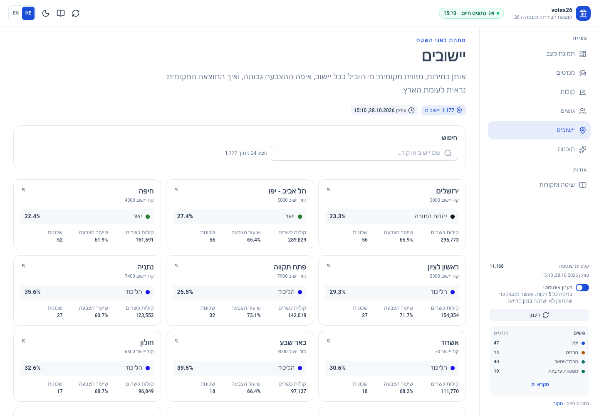
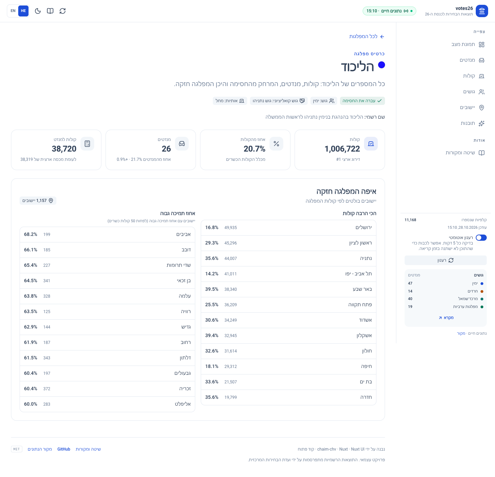
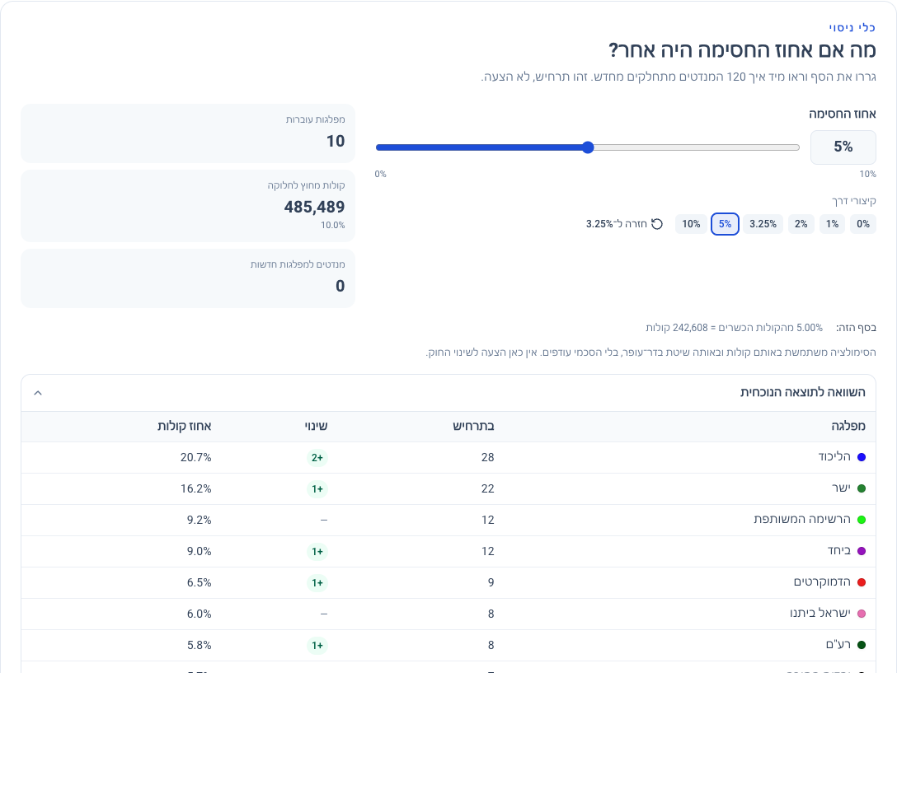

# votes26

An accessible, clear, live view of Israel’s 26th Knesset election results.  
תצוגה נגישה וברורה של תוצאות הבחירות לכנסת ה-26 — קולות, מנדטים, גושים ותובנות.

[](https://nuxt.com)
[](https://ui.nuxt.com)
[](LICENSE)

| Hebrew (RTL) | English (LTR) |
| --- | --- |
|  |  |

<details>
<summary>Mobile layout</summary>



</details>

## What it is

The election result is two stories at once:

- **Votes** — how many people chose each party, including parties that did not pass the 3.25% threshold.
- **Seats** — how 120 Knesset seats are actually allocated after the threshold removes the parties that did not qualify.

`votes26` lets you move between those stories without losing the thread. It also shows the political blocs, the coalition arithmetic, and the places where the seat system makes votes and power diverge.

The interface is Hebrew-first and RTL, with a complete English/LTR mode. Both are designed to be read by screen readers and keyboard users.

## Views

| View | Route | Question it answers |
| --- | --- | --- |
| **Overview** | `/` | What does the House look like right now, and who can reach 61 seats? |
| **Seats** | `/mandates` | Which parties passed the threshold, and how were 120 seats divided? |
| **Votes** | `/votes` | How many votes did every party get, and how does vote share compare with seat share? |
| **Blocs** | `/blocs` | How are the seats split between right, Haredi, center-left and Arab parties? |
| **Localities** | `/localities` | Who led in each locality, what was turnout, and how does the local result compare with the country? Drill down to neighbourhoods where the source publishes them. |
| **Party profile** | `/parties/:code` | Every number for one party: vote share, seats, threshold distance, national comparison, and its strongest localities. Linked from the charts and tables. |
| **Insights** | `/insights` | What did the threshold and the seat system do to representation? |
| **Method** | `/method` | Where does the data come from, how is it calculated, and what are the limits? |

| Localities | Party profile |
| --- | --- |
|  |  |

The **Seats** view also includes a threshold simulator: drag the threshold from 0% to 10% and see the 120 seats redivide. Below it, the below-threshold table explains exactly how many votes each party needed to pass, with the closest miss called out.



The sidebar contains the view navigation, the live-update status, an auto-refresh switch, a compact bloc legend, and a button that opens the full slide-out legend.

## Accessibility

Accessibility is part of the product, not a cleanup pass.

- Hebrew RTL by default, English LTR on demand; the language choice is remembered in a cookie.
- A skip link, semantic landmarks, one `<h1>` per page, visible focus rings and keyboard-operable controls.
- Charts are never the only source of information. The seat map has a text summary and an adjacent party list; vote and comparison charts have text values; data tables have captions and scoped headers.
- Party colour is always paired with a name, a number, or a pattern.
- Dark mode, reduced-motion support, and a pause for auto-refresh so content does not change under someone who is reading.
- Automated checks with [axe-core](https://github.com/dequelabs/axe-core) report **0 WCAG A/AA violations on all routes in both light and dark mode** (28 Oct 2026). Lighthouse scores **100 for accessibility** on every tested route. This is a floor, not a substitute for manual testing with real assistive technology.

## Data

The app reads the public results feed published by **Govmap**, the Israeli national mapping centre:

- Live feed: `https://elections.govmap.gov.il/data/votes/latest/municipal_data.json`
- Election metadata: `https://elections.govmap.gov.il/data/votes/elections.json`
- Neighbourhood feed: `https://elections.govmap.gov.il/data/votes/latest/neighborhood_data.json`
- Official national results: `https://votes26.bechirot.gov.il/nationalresults?lang=he`

The server normalises the locality-level feed into national party totals and caches it for 90 seconds. The browser refreshes every 5 minutes. If the live feed cannot be reached, the app serves a bundled snapshot and says so in the UI.

`bun run snapshot` refreshes that fallback file from the live feed. `bun run geo-names` refreshes the compact neighbourhood-name map used by the locality drill-down.

> The results are provisional until the Central Elections Committee publishes the final results in the official record. Recounts, envelope counts and surplus-vote agreements can change the numbers.

## How seats are calculated

1. Parties below **3.25%** of valid votes are excluded from the allocation.
2. The remaining votes are divided by **120** to get a seat quota.
3. Each qualifying party receives whole seats in proportion to its votes.
4. Remaining seats go to the largest remainders (Bader–Ofer).

This implementation does **not** apply optional surplus-vote agreements between lists, so a final official result can differ by a seat or two. The site labels the allocation as calculated, not official.

The **blocs** are an editorial reading aid:

- Right
- Haredi
- Center-left
- Arab parties
- Other

The **Netanyahu bloc** and **Change bloc** on the coalition screens are a separate analytical split based on public positions. Neither grouping is official, binding, or a forecast.

## Tech stack

- [Nuxt 4](https://nuxt.com)
- [Nuxt UI 4](https://ui.nuxt.com) + Tailwind CSS 4
- TypeScript
- [Bun](https://bun.sh) for installs, scripts and tests

The calculation code is pure TypeScript in `shared/election/`, shared by the server and the test suite.

## Getting started

Requires Bun 1.4+.

```bash
bun install
bun run dev
```

Open <http://localhost:3000>.

### Scripts

| Command | What it does |
| --- | --- |
| `bun run dev` | Start the development server |
| `bun run build` | Build the production server |
| `bun run preview` | Preview the production build |
| `bun run typecheck` | Run Nuxt/Vue type checking |
| `bun run test` | Run the calculation, threshold and locality unit tests |
| `bun run test:e2e` | Run the Playwright end-to-end suite (Chrome) |
| `bun run test:all` | Run unit and end-to-end tests |

The E2E suite uses the installed **Chrome** channel. On CI without Chrome, run `bunx playwright install chromium` and switch the channel in `playwright.config.ts`.
| `bun run snapshot` | Refresh `server/data/snapshot.json` from the live feed |
| `bun run geo-names` | Refresh the neighbourhood id/name map from the Govmap geometry |

### Configuration

Copy `.env.example` if you need to override the feed:

```bash
NUXT_VOTES_SOURCE_URL=https://elections.govmap.gov.il/data/votes/latest/municipal_data.json
NUXT_VOTES_CATALOG_URL=https://elections.govmap.gov.il/data/votes/elections.json
```

`NUXT_DEVTOOLS=true` enables Nuxt DevTools locally. `NUXT_VOTES_NEIGHBORHOOD_URL` overrides the neighbourhood feed.

## Project structure

```text
app/
  app.vue                 # UApp + layout
  app.config.ts           # Nuxt UI semantic colours
  components/             # header, sidebar, charts, builder, legend
  composables/            # results, locale, formatting
  i18n/messages.ts        # Hebrew + English copy
  layouts/default.vue     # shell, skip link, slide-overs
  pages/                  # national views, localities, party profiles
  assets/css/main.css     # Tailwind, Nuxt UI, tokens, motion/print rules
server/
  api/results.get.ts      # cached national results endpoint
  api/localities.get.ts   # compact locality list
  api/localities/[code].get.ts # locality + neighbourhood drill-down
  api/parties/[code].get.ts    # a party's strongest localities
  utils/votes-data.ts     # cached source fetches
  utils/source.ts         # live national snapshot
  utils/normalize.ts      # raw snapshot -> ResultsPayload
  utils/localities.ts     # locality / neighbourhood / party-local aggregation
  data/snapshot.json      # fallback snapshot
  data/neighborhood-names.json # static id -> neighbourhood name map
shared/election/
  config.ts               # 120 seats, 61 majority, 3.25%, date
  types.ts                # raw + normalised contracts
  parties.ts              # names, colours, blocs, editorial camps
  allocation.ts           # Bader-Ofer / largest remainder + indices
scripts/fetch-snapshot.ts # fallback snapshot refresher
scripts/fetch-neighborhood-names.ts # neighbourhood name map refresher
test/                     # bun:test unit suites
e2e/                      # Playwright navigation, data-refresh and a11y tests
playwright.config.ts      # E2E runner, Chrome channel
docs/                     # README screenshots
```

## Deploying

The app needs a Node server because `/api/results` proxies and caches the live feed.

```bash
bun run build
PORT=3000 bun .output/server/index.mjs
```

A static export is not enough unless you replace the server route with a client-side fetch and accept the source’s CORS behaviour. Vercel, Netlify, Render, Fly.io or any Node host work.

## Roadmap

Possible next steps, in rough order of value:

- Historical comparison with the 24th and 25th Knessets.
- CSV/JSON export and a printable results sheet.
- Party-vs-party comparison view.
- Manual screen-reader and zoom testing on Windows and mobile.

## Contributing

Issues and pull requests are welcome. Before opening a PR:

```bash
bun run test
bun run typecheck
bun run test:e2e
```

Please keep new UI Hebrew/English complete, use logical CSS properties for RTL, and include a text alternative for any new chart.

## License

MIT © 2026 [chaim-chv](https://github.com/chaim-chv). See [LICENSE](LICENSE).

This is an independent project. It is not affiliated with the Central Elections Committee, Govmap, or the Israeli government. The data is subject to the source’s terms.
